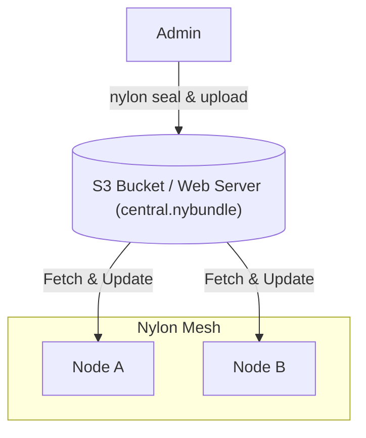

import { Steps } from '@astrojs/starlight/components';

Nylon's distribution system allows you to manage network topology from a central source using signed and encrypted "bundles".



:::caution
Despite being called a "public" key, the distribution key also acts as the shared secret for decrypting your network config. To keep your internal network structure private, only share this key with the nodes in your network.
:::

<Steps>

1. ### Generate a Distribution Keypair

   First, generate a keypair specifically for distribution (separate from node keys).

   ```bash
   nylon key > dist.key 2> dist.pub
   ```

2. ### Seal your Configuration

   Sign and encrypt your `central.yaml` into a `.nybundle` file.

   ```bash
   nylon seal -c central.yaml -k dist.key -o central.nybundle
   ```

   `nylon seal` parses the central config **strictly**: a key the schema does not model (a typo, or a section at an unsupported level) fails the seal with an error instead of silently vanishing from the distributed bundle. The receiving side applies the same guarantee — a bundle carrying a field the binary does not know fails the poll loudly and the node keeps its last active config rather than half-applying the update.

   **Comments are stripped from the bundle; your raw `central.yaml` keeps them.** The distributed `central.nybundle` is clean config — `nylon seal` parses your (strictly, comments included) file and re-renders the config without comments, so `nylon open` prints the plain text the nodes run. Your hand-written `central.yaml` is the only place the documentation lives, and nothing strips it from there: when the daemon refreshes its local `central.yaml` — at startup after a fetch, or on every applied poll update — it re-renders the new values **carrying over the comments of the file it overwrites**, so a documented central.yaml stays documented even on the node that runs `file:`-scheme repos next to it. Comments map by YAML path: a comment survives while its path does (edit a value — the note stays; delete a section — its notes go with it).

3. ### Publish the Bundle

   Host `central.nybundle` on any HTTP/HTTPS server (e.g., GitHub Pages, S3, or Nginx). A `file:`-scheme repo serves the bundle from the local filesystem — both the relative historical form (`file:central.nybundle`, resolved against the daemon's working directory) and the absolute form (`file:///srv/nylon/central.nybundle`) work.

4. ### Configure Nodes

   #### Initial Bootstrap (`node.yaml`)
   Nodes fetch their first central config using the `dist` block:

   ```yaml title="node.yaml"
   dist:
     url: "https://your-server.com/central.nybundle"
     key: "<contents-of-dist.pub>"
     interval: "1h" # optional
   ```

   The `url` and `key` in the `dist` block of `node.yaml` are the bootstrap **links**. Startup reads them leniently — only the `dist` block and the DNS resolvers are extracted, so a legacy-shaped `node.yaml` can still bootstrap — fetches the latest published bundle over them, and only then decides whether the configuration is valid to run. The local `central.yaml` is a **cache**, not the source of truth:

   - a strictly newer published bundle wins, and the cache is refreshed (comment-preserving — see the seal step above);
   - a cache that no longer parses under this binary (a stale shape left by a version update, while the fresh central is already published) is **bypassed**, not fatal — the fetch replaces it;
   - the cache still serves when the links are absent (a `file:`-mounted stand), unreachable (offline start) or the published bundle is not newer;
   - when nothing can run, startup fails with ONE error naming both causes — the stale cache and the failed fetch.

   The winning source is journalled on every start: `starting nylon ... central_config_source=dist (file:/srv/nylon/central.nybundle)` (or `central_config_source=local cache (dist fetch failed: ...)`), so a bypassed stale cache is visible in the logs.

   The optional `interval` outlives bootstrap — it acts as the fallback polling cadence while the active central config's `dist` block sets no `interval` of its own.

   #### Automatic Updates (`central.yaml`)
   Once bootstrapped, nodes poll the repositories defined in `central.yaml`:

   ```yaml title="central.yaml"
   dist:
     key: "<contents-of-dist.pub>"
     repos:
       - "https://your-server.com/central.nybundle"
     interval: "6h" # optional
   ```

   Nylon polls for updates on the resolved cadence — the `interval` from `central.yaml` takes precedence, then the `interval` from `node.yaml`, then the built-in default of 10 seconds — and applies a bundle only when its timestamp is strictly newer than the active config. Interval changes distributed inside a config update take effect live, without a restart. `nylon seal` rewrites that timestamp to the sealing host's wall clock, so each seal is newer by construction; re-uploading an older bundle is ignored, and clock skew on the sealing host can block rollout.

</Steps>

## Observing the poll loop

Every poll round is visible in the journal, which makes "why is my node still hitting the config sources every 10 seconds" answerable from the logs alone:

- `config poll loop started interval=1h0m0s interval_source=central repos=1` — the effective cadence at startup and where it came from (`central` = `dist.interval` of the active central config, `node` = `dist.interval` in `node.yaml`, `default` = built-in 10 seconds).
- `checking config sources for updates repos=1 interval=1h0m0s interval_source=central` — one record per poll attempt, before the fetches start.
- `config bundle is not newer than the active config, skipping repo=... bundle_timestamp=... active_timestamp=...` — the source was reached but still serves a bundle that is not newer than the active one. Equal or older timestamps mean the re-seal or re-upload never landed (for example, an edit to the plain `central.yaml` without running `nylon seal`, or a bundle sealed by an older binary that silently drops unknown fields such as `interval`).
- `failed to fetch config update repo=... err=...` — the source could not be reached, the bundle failed to verify, or its config failed the strict parse (a field this binary does not know — version skew; the node keeps its last active config).
- `config poll interval changed from=10s to=1h0m0s interval_source=central` — a live interval change distributed inside a config update.

Note that an `interval` added to a served `central.yaml` only takes effect after the bundle carrying it is applied — the apply requires a strictly newer timestamp, so a missing re-seal keeps the old cadence while the log lines above show exactly that.

## Key rotation

When `dist` is configured, `dist.key` must be set to a nonzero public key. To rotate it, put the new public key in `central.yaml` and sign that bundle with the old private key. That transition seal deliberately logs the warning `bundled public key differs from the signing key, check if this is intended!`, because the bundle is sealed with the old key (so old-key nodes can open it) while already carrying the new `dist.key`. After nodes apply the bundle, sign subsequent updates with the new private key; seals with the new key no longer warn.
